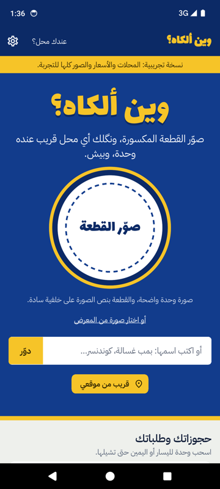
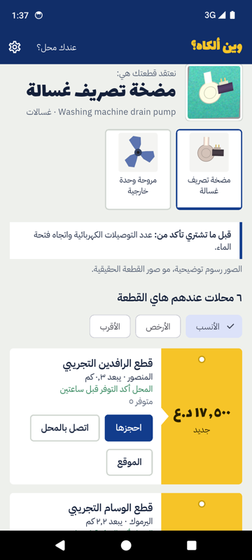
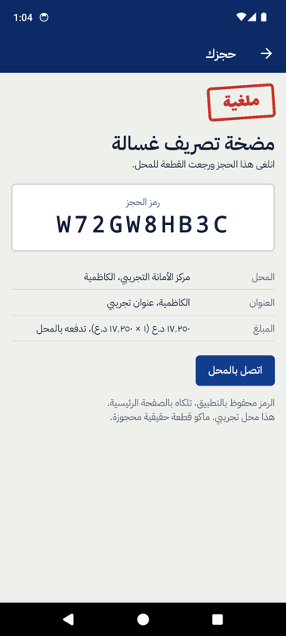
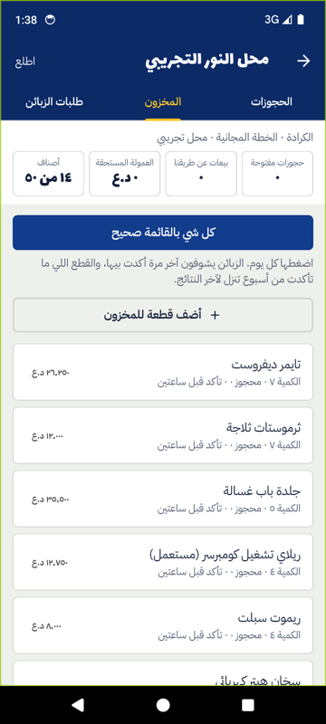
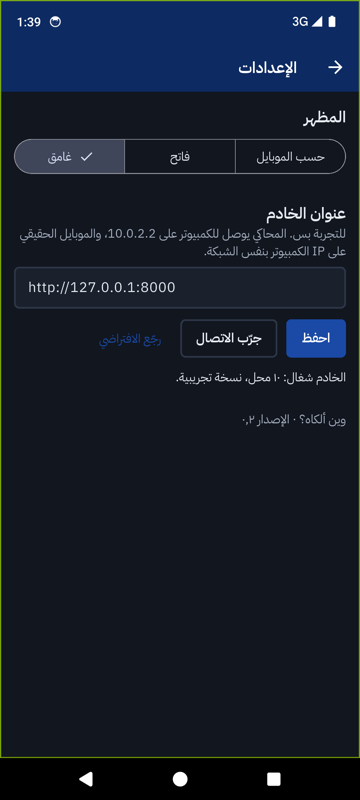

# وين ألكاه؟ — تطبيق الموبايل (Flutter، أندرويد)

تطبيق Flutter لمشروع **وين ألكاه؟**: تصوّر قطعة غيار مكسورة لجهاز منزلي، ويكلك أي محل ببغداد عنده وحدة وبيش.
يستعمل نفس الـ API مال الباكند (Django) بمشروع WAIN.

## الميزات

**للزبون**
- البحث بالصورة (الكاميرا أو المعرض) أو بالاسم، ويا صور تجريبية بالنسخة التجريبية.
- النتائج: صياغة حسب ثقة التعرّف، قطع مشابهة تختار بيناتها، و«قبل ما تشتري تأكد من».
- المحلات كبطاقات سعر صفرة: مدى حداثة المخزون، المسافة، اتصال، الموقع على الخريطة.
- **ترتيب وفلترة**: الأنسب، الأرخص، الأقرب، جديد أو مستعمل.
- **اختيار المنطقة**: GPS أو منطقة من بغداد (الكرادة، المنصور…)، والمسافات تنحسب منها.
- الحجز (المحل يحجز القطعة ٣ ساعات) ومتابعته وإلغاؤه، والشاشة تتحدث وحدها.
- طلب القطعة النادرة من كل المحلات ومتابعة العروض.
- **حجوزاتك وطلباتك** محفوظة بالموبايل، و**فتح أي حجز أو طلب برمزه**، ونسخ الرمز.

**لصاحب المحل** (زر «عندك محل؟»)
- دخول وتسجيل محل جديد.
- لوحة: الحجوزات المفتوحة، المبيعات، العمولة، عدد الأصناف، والأصناف اللي ما تأكدت.
- الحجوزات: تأكيد، استلام، إلغاء، والاتصال بالزبون.
- المخزون: «كل شي بالقائمة صحيح»، تعديل السعر والكمية، الحذف، إضافة قطعة من الكتالوج، واقتراح قطعة جديدة بصورة.
- طلبات الزبائن: إرسال عرض سعر، وقائمة القطع اللي الناس تدوّر عليها وهي مو عندك.

**عام**: عربي من اليمين لليسار بلهجة عراقية، خطوط Lalezar و IBM Plex Sans Arabic، مظهر فاتح وغامق، أيقونة التطبيق، وإعدادات لعنوان الخادم.

## صور

| الرئيسية | النتائج | الحجز | مخزون المحل | الإعدادات (غامق) |
|---|---|---|---|---|
|  |  |  |  |  |

## التشغيل

```bash
export PATH="$HOME/development/flutter/bin:$PATH"
cd ~/projects/wain/WAIN/mobile
flutter pub get
flutter analyze
flutter test
```

### على محاكي أندرويد

الخادم لازم يقبل العنوان `10.0.2.2` (هذا عنوان الكمبيوتر من داخل المحاكي):

```bash
cd ~/projects/wain/WAIN && WAIN_ALLOWED_HOSTS=localhost,127.0.0.1,10.0.2.2 ./run.sh
```

```bash
flutter run
```

إذا الخادم شغال أصلاً بدون `10.0.2.2` (يرجع 400)، وصّل المنفذ بـ adb واستعمل 127.0.0.1:

```bash
adb reverse tcp:8000 tcp:8000 && flutter run --dart-define=WAIN_API=http://127.0.0.1:8000
```

### على موبايل حقيقي بنفس الشبكة

شغّل الخادم على `0.0.0.0` وأضف IP الكمبيوتر لـ `WAIN_ALLOWED_HOSTS`، بعدين:
`flutter run --dart-define=WAIN_API=http://192.168.1.20:8000`
أو غيّر العنوان من داخل التطبيق: ⚙️ الإعدادات ← عنوان الخادم ← «جرّب الاتصال» ← «احفظ».

### حساب محل تجريبي

`seed_demo` يسوي المحلات `shop1` … `shop10`، وكلمة السر بـ `WAIN/var/demo_credentials.txt`.

نسخة الـ debug تسمح بـ HTTP العادي؛ نسخة الـ release تحتاج HTTPS.

## الملفات

| الملف | شنو بيه |
|---|---|
| `lib/api.dart` | النماذج والاتصال بالـ API (`WainApi`، يقبل `http.Client` للاختبار) |
| `lib/home.dart` | الصفحة الرئيسية: زر التصوير، البحث بالاسم، الصور التجريبية، حجوزاتك |
| `lib/results.dart` | النتائج: صياغة الثقة، القطع المشابهة، «قبل ما تشتري تأكد من» |
| `lib/price_tag.dart` | بطاقة السعر الصفرة لكل محل |
| `lib/reserve.dart` | ورقة الحجز |
| `lib/track.dart` | متابعة الحجز وإلغاؤه |
| `lib/requests.dart` | طلب قطعة نادرة ومتابعة العروض |
| `lib/shop.dart` | بوابة المحلات: الدخول، اللوحة، الحجوزات، المخزون، طلبات الزبائن |
| `lib/settings.dart` | المظهر وعنوان الخادم |
| `lib/state.dart` | حالة التطبيق: الخادم، المظهر، دخول المحل |
| `lib/theme.dart` | ألوان `frontend/src/styles.css` وخطوط Lalezar و IBM Plex Sans Arabic |
| `tool/make_icons.py` | يرسم أيقونة التطبيق (`python3 tool/make_icons.py`) |

الخطوط بـ `assets/fonts` (رخصة SIL OFL).
